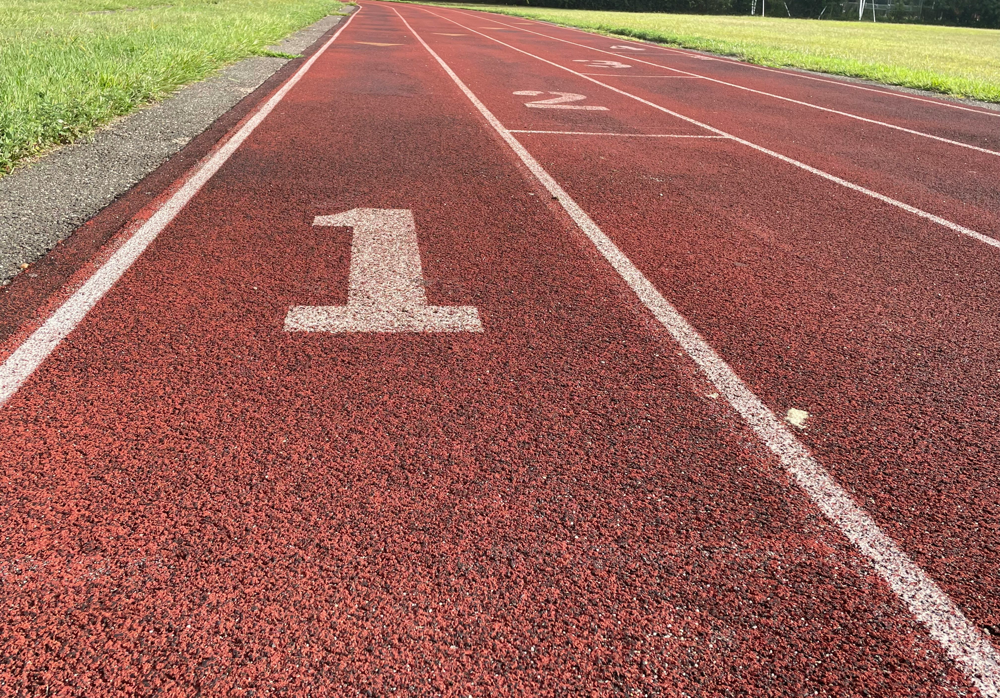
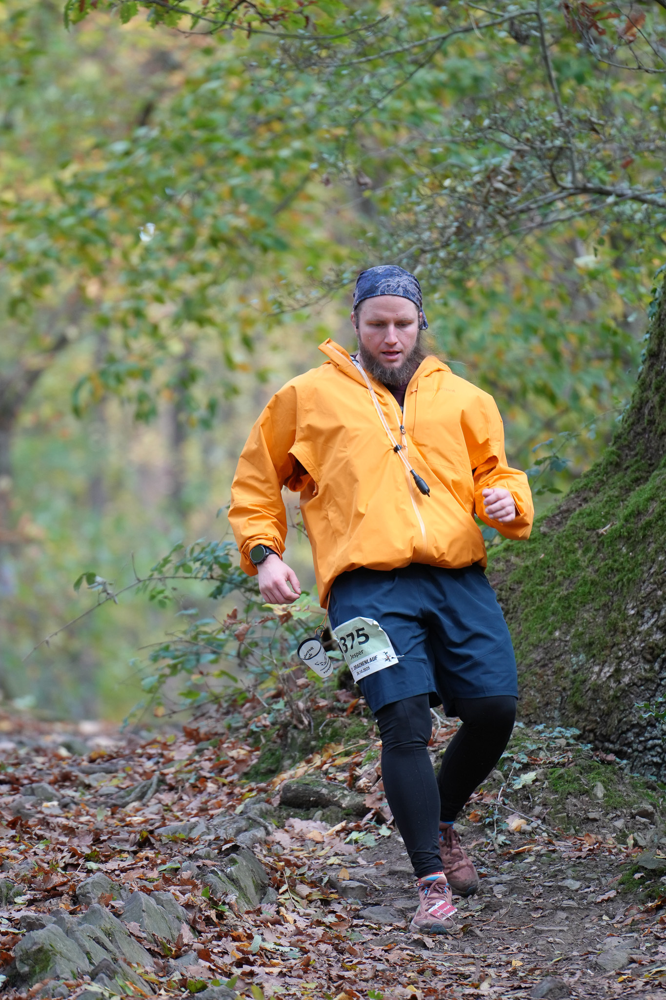
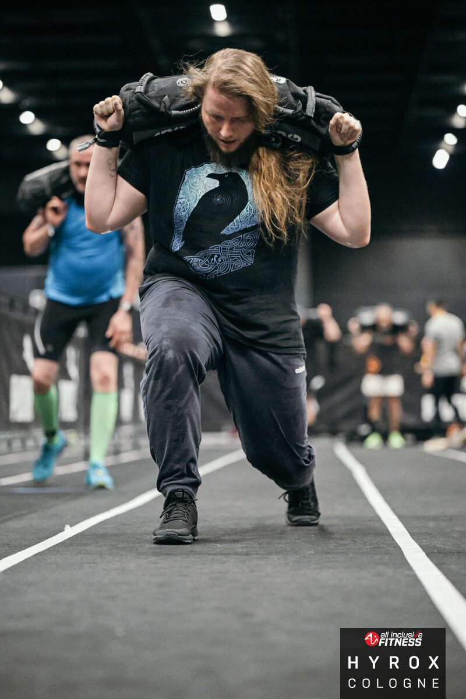
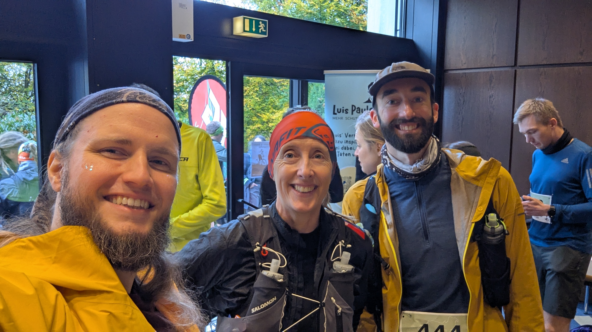
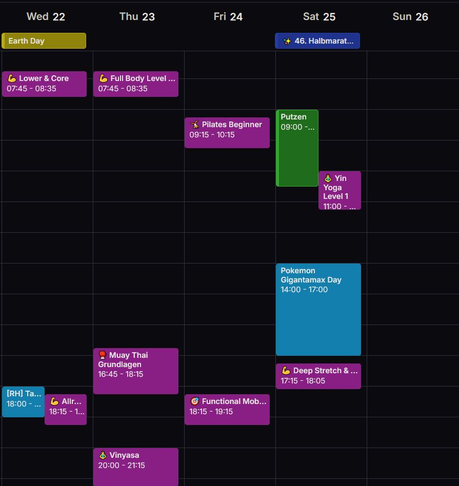
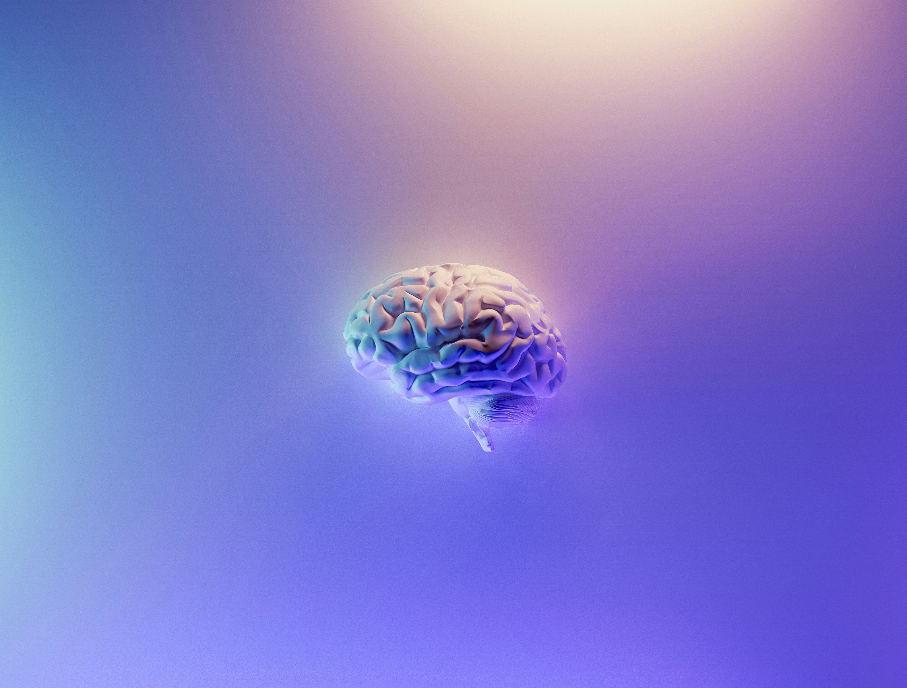
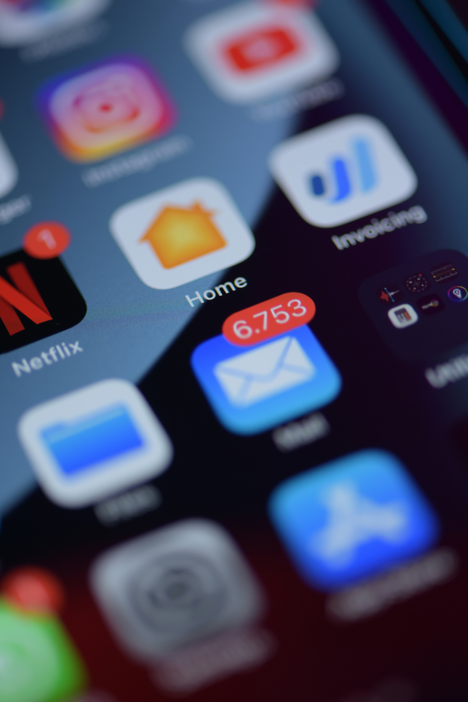
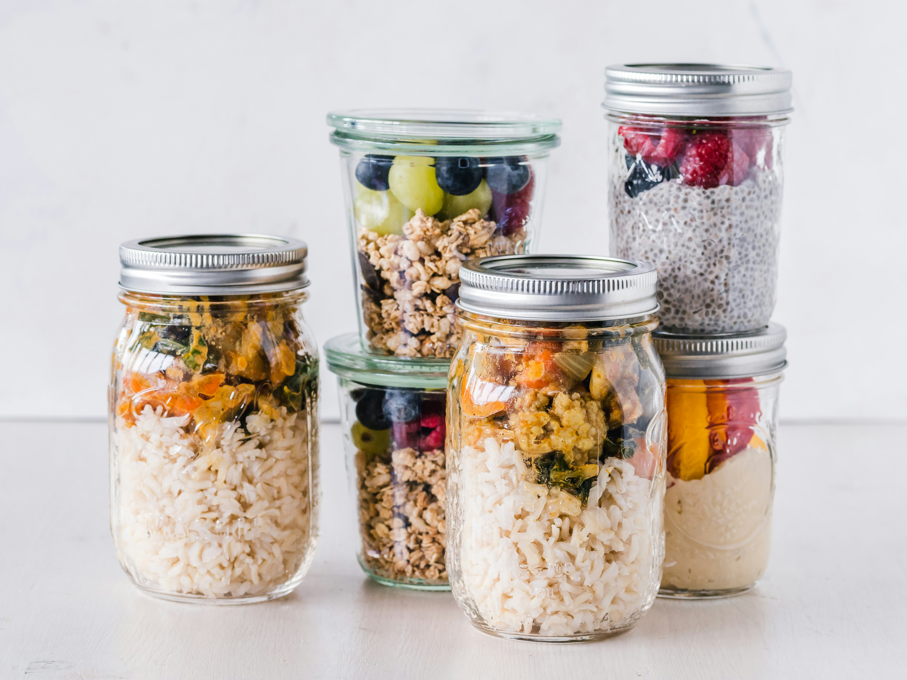

<!-- _class: invert lead -->

# How I Stopped Worrying and Started Loving the B~~omb~~urpee <!--fit-->

Jesper Dramsch (they/them)

---

<!-- _class: lead -->

🧘 Every movement has a **seated option**.

Meet your body where it is.

---

<!-- _class: lead -->

🧘 Stand if you can. Feet grounded. Arms by your sides.

**Three breaths. Arrive in your body.**

---

## Why? What?

&nbsp;

> "I said I only want to talk about sports."
>
> Katherine said: _then talk about non-binary sports._

&nbsp;
&nbsp;

---

## So here I am

-   Sport is where I feel most _myself_
-   But there's layers
-   Body, brain, burnout, burpees, and AI
-   We're going to **move** through them together

---

<!-- _class: invert lead -->

# The Body <!--fit-->

Non-binary in sport

---

## The Paradox

-   Moving, breathing, pushing limits
-   But sports _structures_ are obsessively binary
-   Categories, changing rooms, kit sizing
-   "Ladies' pace" and "girl's weights"

---

## Community

-   Actual communities care if you **show up**
-   Bonding through shared suffering
-   Through shared experience
-   Not shared chromosomes

---

## The Switch in my Brain

&nbsp;

&nbsp;

**Society says:** my body is "wrong" by default

**Sport says:** my body is _what it can do_

That's radical. That's healing.

&nbsp;

&nbsp;

---

## _Glitch Feminism_

&nbsp;

> "Glitch carries a technology of remix within its code."
> ~ Legacy Russell

The "glitch" as liberation — refusing to be legible.

My existence that doesn't render properly isn't _broken_ — it's **refusal**.

&nbsp;

---

<!-- _class: lead -->

🧘 **Hamstring sweeps**

Sweep one leg forward, then the other.

Take up space. Claim the room in front of you.

_(Seated: leg extensions, sweeping arms)_

---

<!-- _class: invert lead -->

# My silly little brain <!--fit-->

ADHD & the invisible labor

---

## Inbivisible Problem

-   I **love** sport
-   Getting _to_ sport is the hard part
-   On time is basically impossible
-   Planning it is torture

---

## The Invisible Labor

-   Time blindness
-   Executive dysfunction
-   Notification habituation
-   Hyperfocus

&nbsp;

---

## What It Costs

&nbsp;

-   Missing classes I genuinely wanted
-   The shame spiral
-   Sport isn't just fitness — it's **mood regulation**
-   Missing it has real consequences

&nbsp;

&nbsp;

---

<!-- _class: lead -->

🧘 **Full body shake-out**

Shake your hands. Your arms. Your whole body.

Let the noise go. Reset your nervous system.

_(Seated: shake hands, roll shoulders, wiggle)_

---

<!-- _class: invert lead -->

# The Burnout <!--fit-->

Sport as medicine

---

## My Context

-   Three consecutive burnouts. Severe.
-   Part-time work is necessary
-   At the worst: **dissociated from my body**
-   Vessel carrying my brain

---

## Signs of Burnout

&nbsp;

-   Exhaustion that sleep doesn't fix
-   Cynicism about work you used to love
-   Feeling ineffective despite effort
-   Dissociation from your body
-   "Just getting through" every day

&nbsp;

&nbsp;

---

## Way Back

&nbsp;

-   Not to "get fit"
-   Something physical without deliverable
-   The workout doesn't need to "count"
-   Joy in Movement

&nbsp;

---

## The Narrative I Reject

&nbsp;

**Fitness industry:** optimize, achieve,  grind, earn your rest

**My version:** showing up is the win.  Rest is part of the practice.

This is political. This is feminist.

&nbsp;

---

## A Burst of Light

&nbsp;

> "Caring for myself is not self-indulgence, it is self-preservation, and that is an act of political warfare."

&nbsp;

Written while battling cancer.

Self-care isn't candles — it's **staying alive to keep fighting**.

---

<!-- _class: invert lead -->

# Movement isn't indulgence. <!--fit-->

## It's Resistance.

---

<!-- _class: lead -->

🧘 **Grounded breath**

Hands on your ribs. Feel them expand.

This is not indulgence. This is infrastructure.

_(Same seated or standing)_

---

<!-- _class: invert lead -->

# Bottie McBotFace <!--fit-->

AI as accessibility

---

## What "AI for Good" Actually Looks Like<!--fit-->

&nbsp;
&nbsp;

-   Not sexy. Not revolutionary.
-   **Mundane and useful.**
-   I built (with Claude) an ADHD-friendly calendar system

&nbsp;
&nbsp;

---

## What It Does

&nbsp;
&nbsp;

-   Text to ICS
-   Fake early start time
-   Two notification types
-   Catches duplicates

&nbsp;

&nbsp;

---

## Contrary to the Hype

&nbsp;

-   AI isn't coaching me
-   AI isn't optimising my performance
-   It's **protecting my recovery infrastructure**
-   Technology that _accommodates_, not "fixes"
-   & meets me where I am

&nbsp;

&nbsp;

---

## A Cyborg Manifesto

&nbsp;

> "I would rather be a cyborg than a goddess."

&nbsp;

Reject the myth of natural purity. Embrace the hybrid.

My ADHD-ICS calendar skill is literally me **becoming cyborg**.

&nbsp;

---

<!-- _class: lead -->

🥊 **Guard stance**

Hands up. Protect your face.

**Protect your infrastructure.**

_(Seated: same upper body position)_

---

<!-- _class: invert lead -->

# Why now though?! <!--fit-->

The feminist urgency

---

## Fascism

... Is Obsessed With Bodies

-   Who has the "right" body
-   Who gets to take up space
-   Who is "degenerate"
-   This moment is about **bodily autonomy**

---

<!-- _class: lead -->

🥊 **Teep**

From your guard — push forward.

**Knee up, foot out. We stay ready. We stay visible.**

_(Seated: knee raise, pushing motion with hands)_

---

## Why This Matters for Sport

&nbsp;

&nbsp;

-   Existing visibly is **political now**
-   Finding joy — not optimizing — is **resistance**
-   My communities are **mutual aid networks**

&nbsp;

&nbsp;

---

## The Thread Is Autonomy

&nbsp;

-   Sport gave me my body back after burnout
-   Community gave me people who see _me_, not my gender
-   AI gives me access to the thing that keeps me well
-   **Body, time, brain — all under my control**

That's living feminist.

&nbsp;

---

<!-- _class: lead -->

🏋️ **The Burpee**

Down to the ground. Push back up. Jump.

**Fall down. Get back up. Repeat.**

That's the whole talk.

_(Seated: push hands down, pull back up with energy)_

---

<!-- _class: invert lead -->

# The Finisher <!--fit-->

---

## The Benefit

&nbsp;

The most radical thing AI does for my sports life isn't analysis or coaching.

It's giving me **time to shower and find my workout clothes**.

---

## Conclusion

&nbsp;
&nbsp;

-   **Non-binary body** → where I feel most embodied
-   **ADHD brain** → the invisible labor to get there
-   **Burnout history** → sport as care, not achievement
-   **The political moment** → existing in joy as resistance
-   **AI as tool** → mundane, useful, human

&nbsp;

---

<!-- _class: lead -->

🧘 **Forward fold**

Fold forward. Let your head hang.

Slowly roll up, one vertebra at a time.

**Come back into yourself. You're still here.**

---

## Let's Talk

&nbsp;

&nbsp;

-   What's your "invisible labor" that could use accommodation?
-   Where have you found community beyond the binary?
-   What does resistance through joy look like for you?

&nbsp;

&nbsp;

---

<!-- _class: invert lead -->

# Thank you <!--fit-->

## @JesperDramsch · they/them

feministai.party
